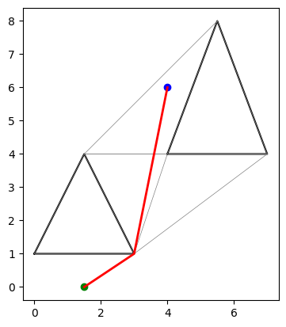
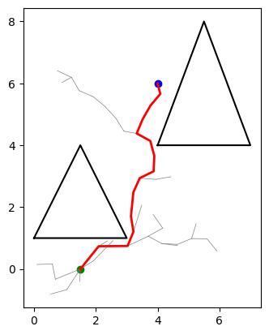
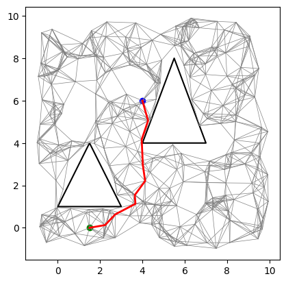

# Path Planning: Visibility Graph vs RRT\* vs PRM

The goal of this work is to compare existing pathfinding solutions in terms of **time complexity**, **runtime**, and **path length**.

## Algorithms

| VG | RRT\* | PRM |
|:---:|:---:|:---:|
|  |  |  |

- **VG**: nodes are the vertices of obstacles (polygons), edges connect pairs of vertices that can "see" each other. Searching it with Dijkstra gives the **exact shortest path**.
- **RRT\***: builds a space-filling tree from random samples, biased toward the largest unsearched regions. RRT\* also **rewires** nearby nodes, so the path converges toward the optimal one as samples grow.
- **PRM**: randomly samples free points and connects nearby ones with a local planner into a roadmap. The roadmap can be **reused** for new start/goal queries.

Gray: graph or tree, red: found path, green: start, blue: goal. Step-by-step walkthrough: [`seminars.ipynb`](seminars.ipynb).

## Comparison

| Notebook | Question |
|---|---|
| [`compare_scenario1_full_runtime`](compare/compare_scenario1_full_runtime.ipynb) | Runtime of one query from scratch (graph built + search) |
| [`compare_scenario2_search_only`](compare/compare_scenario2_search_only.ipynb) | Runtime of a query when the graph is already built |
| [`compare_path_length`](compare/compare_path_length.ipynb) | Path length, relative to the exact VG shortest path |
| [`compare_dense_scaling`](compare/compare_dense_scaling.ipynb) | Runtime as the number of obstacles grows (50–200) |

Test maps (7 batches × 10 maps: few/many, convex/concave, empty, random placement, …) are generated with [`polygenerator`](https://pypi.org/project/polygenerator/) in [`maps/maps.ipynb`](maps/maps.ipynb).

## Structure

```
algorithms/   PRM and RRT* implementations
utils/        map generation, benchmarking, tables, plots
maps/         map generation notebook + saved maps (maps_batches.json)
compare/      comparison notebooks
seminars.ipynb  introduction to the three algorithms and obstacles creation
```

## Run

```bash
python -m venv venv && source venv/bin/activate
pip install -r requirements.txt
```

Open the folder in VS Code (notebooks run from the project root via `.vscode/settings.json`), then run `maps/maps.ipynb` and the notebooks in `compare/`.
